# TB-AMR Agent Team — architectural implementation

This document describes how the v0.2 system is built: the processes, the modules, the six-stage pipeline, the agent loop, the decision contract, and the persistence that makes every judgment auditable.

The product is a hybrid agentic workflow for *Mycobacterium tuberculosis* drug-resistance genomic evidence (A.G.E.N.T. Playbook capstone, TB antimicrobial resistance). Claude agents choose tools and stop conditions. Rule agents execute the steps that must be reproducible. The Orchestrator moves work between them and stops at every human gate. Genomic predictions are not laboratory-confirmed susceptibility and cannot estimate national prevalence.

## 1. Design principles

| Principle | How it is implemented |
|---|---|
| Humans own irreversible judgments | Gates are role-checked in `Orchestrator`. Agents cannot record `Approve` or `Override`. |
| Rules own numbers | QC coverage, finding classification, and report denominators are computed in Python, not by the model. |
| Models propose; guardrails accept | `LLMAgent.validate()` strips invented accessions, restores required scope definitions, and can only make evidence review more cautious. |
| One shared outcome vocabulary | Every agent writes a `Decision` with `Proceed`, `Hold`, `Exclude`, `Retry`, or `Escalate`. |
| History is append-only | Overrides change current sample status and add a new decision. They never delete the original row. |
| Relaxing a safeguard needs two people | A more cautious status applies immediately. A less cautious one waits for a second, different named person. |
| Raw data sits beside the decision | Opening a source records a per-person receipt. The decision evidence line says whether that person opened it. |
| Two interchangeable brains | `ClaudeClient` and `ReplayClient` share `complete()`. Replay is labelled in the trace so it is never mistaken for live reasoning. |

## 2. Runtime context

One Python process serves the API and, when `frontend/dist` exists, the built React app. The browser talks only to that process. External systems are reached only by tools the agents call.

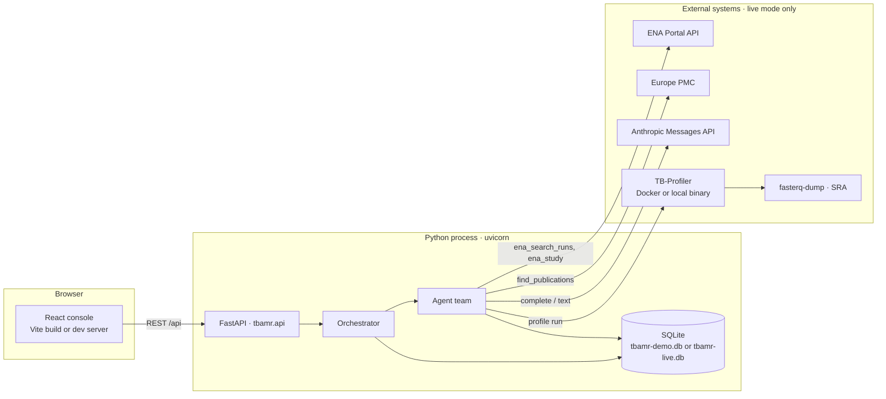

Demo mode never leaves the process. `DemoDataTools` returns simulated ENA, Europe PMC, and TB-Profiler records whose accessions start with `DEMO` or `PRJDEMO`. Replay mode never calls Anthropic.

### How a request is served

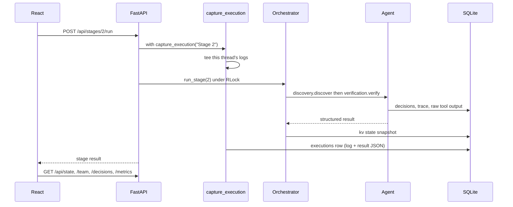

`Orchestrator.lock` is a re-entrant lock. Stage runs, gates, imports, and state saves take it. TB-Profiler workers share it only for the short critical sections that update `busy` and persist state. The profiler batch itself runs on a daemon thread so the HTTP call returns as soon as the pool is started.

## 3. Module map

```
backend/tbamr/
  api.py                 FastAPI app, request models, static file mount
  cli.py                 Headless walkthrough that acts as each human
  harness.py             Seeds a finished demo DB and optionally serves it
  article.py             Standalone HTML article from an already-built report
  core/
    models.py            Roles, stages, gates, rule versions, thresholds, state
    decisions.py         Decision contract, guardrail check, SQLite log
    executions.py        Thread-local log capture for one user action
    orchestrator.py      Hand-offs, gates, re-plan, overrides, metrics, snapshot
  agents/
    base.py              RuleAgent, LLMAgent tool loop
    scope_guardian.py    Stage 1
    discovery.py         Stage 2 search
    verification.py      Stage 2 eligibility + cohort checks
    qc.py                Stage 3 coverage gate
    profiling.py         Stage 4 queue, import, local run
    evidence.py          Stage 5 classification + interpretation notes
    reporting.py         Stage 6 numbers + optional summary draft
  tools/
    ena.py               ENA Portal + Europe PMC (httpx)
    demo.py              Offline stand-in with the same return shapes
    tbprofiler.py        JSON parser (v4–v6) and Docker/local runner
  llm/
    client.py            ClaudeClient, ReplayClient, make_client()
    replay.py            Scripted policies, thoughts prefixed [replay]
frontend/src/
  App.jsx                Shell, polling, role, raw-data context
  api.js                 Fetch wrapper for /api
  components/            Pipeline, review, samples, report, team, logs, flow
```

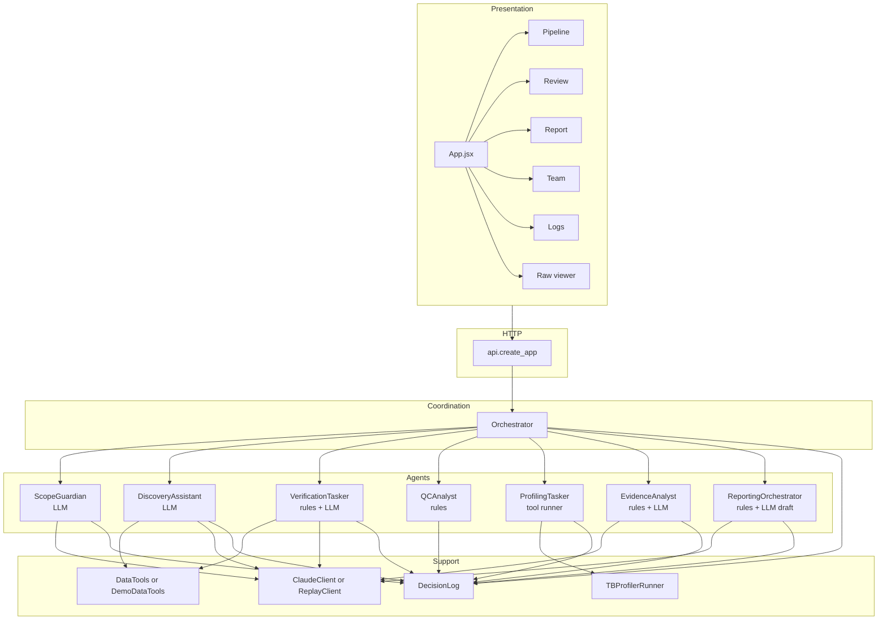

Dependency direction is one way. Agents do not import the Orchestrator. The Orchestrator constructs them and calls a stage method (`review`, `discover`, `verify`, `assess`, `queue`, `evaluate`, `build`). Tools do not know about decisions. The LLM client does not know about pipeline state.

## 4. Configuration

`build_orchestrator()` in `api.py` reads the environment once per process (and again on reset).

| Variable | Effect | Default |
|---|---|---|
| `TBAMR_DATA` | `demo` uses `DemoDataTools`. Anything else uses `DataTools` (live ENA and Europe PMC). | `demo` |
| `TBAMR_BRAIN` | `claude` or `replay`. | `claude` if `ANTHROPIC_API_KEY` is set, else `replay` |
| `ANTHROPIC_API_KEY` | Key for `ClaudeClient`. | unset |
| `CLAUDE_MODEL` | Messages API model id. | `claude-sonnet-5-5` |
| `TBAMR_DB` | SQLite path. | `tbamr-<data>.db` |
| `TBAMR_NO_APP` | When `1`, `api.py` does not build a module-level app. The harness sets this so it can bind its own DB first. | unset |
| `TBAMR_PROFILER_CONCURRENCY` | Parallel TB-Profiler workers. | `max(1, cpu_count // 2)` |
| `TBAMR_PROFILER_THREADS` | Threads inside one `tb-profiler` / `fasterq-dump` invocation. | `4` |
| `TBAMR_PROFILER_BACKEND` | `auto`, `docker`, or `local`. | `auto` |
| `TBAMR_PROFILER_DB` | Database name for a local `tb-profiler` binary. Docker uses the image's bundled DB. | `tbdb` |

`./run.sh` creates `backend/.venv` on first use, sets `TBAMR_DATA` from its first argument, and starts uvicorn on port 8000. `./run.sh live` is the live-data entry point.

CORS allows only the Vite dev origin (`localhost:5173` and `127.0.0.1:5173`). Production use is same-origin: FastAPI mounts `frontend/dist/assets` and serves `index.html` at `/`. Vite's dev server proxies `/api` to `127.0.0.1:8000`.

## 5. Pipeline state machine

`PipelineState` (`core/models.py`) is the only mutable workflow document. It is serialized to the `kv` table under the key `state` after every stage, gate, and profiler save.

| Field | Meaning |
|---|---|
| `question`, `country`, `target_drugs`, `cohort_target` | Researcher scope. Editable only while stage 1 is `ready`. Empty `country` means a worldwide search. |
| `stage_status` | Map `"1"`…`"6"` to `locked`, `ready`, `wait`, or `done`. |
| `scope` | Scope Guardian submission after validation. |
| `samples` | Candidate runs and everything derived from them. |
| `cohort_checks` | Cohort-level findings from `ELIG-v1.1`. |
| `gates` | Who passed scope, cohort, and release, and with what kind. |
| `report` | Latest report dict, or `None`. |
| `replans` | How many times stage 2 has widened the search. Capped at 1. |

A sample keeps eligibility, QC, profiling, and cohort membership as separate fields. A later stage never overwrites an earlier status except through an explicit override or a human resolution.

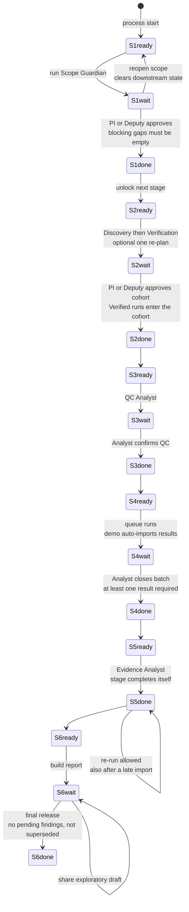

`run_stage` refuses a stage unless it is `ready`, with two exceptions: stage 5 may run again when `done`, and stage 6 may run when `wait` (rebuild). Completing stage *n* moves stage *n+1* from `locked` to `ready`.

Stage 5 is the only agent stage that marks itself `done` without a separate confirm click. Human review of findings happens on the Review queue in parallel; it does not lock the report stage. A review, a late import, or an override sets `report.superseded` so a final release is blocked until the report is rebuilt.

### Roles and gates

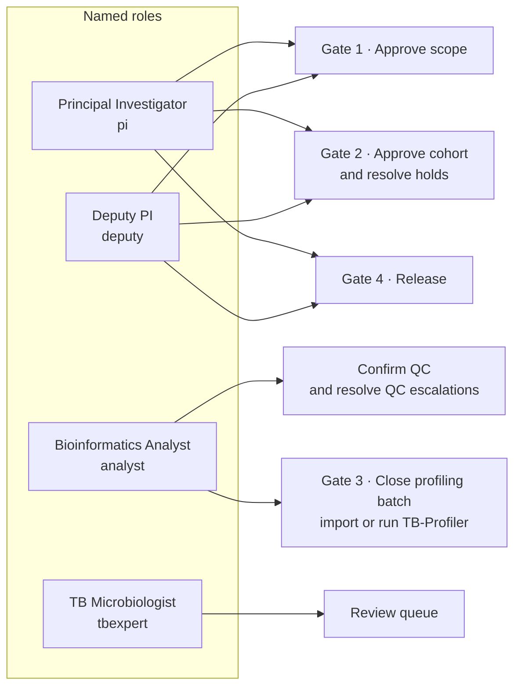

The acting role and person name live in the browser (`localStorage` keys `tbamr.role` and `tbamr.person`) and are sent on every mutating call. The server checks the role. It does not authenticate the person. The name is the audit identity: receipts, two-person co-sign, and decision actors all use it. An empty name falls back to the role label.

## 6. The team and the hand-off

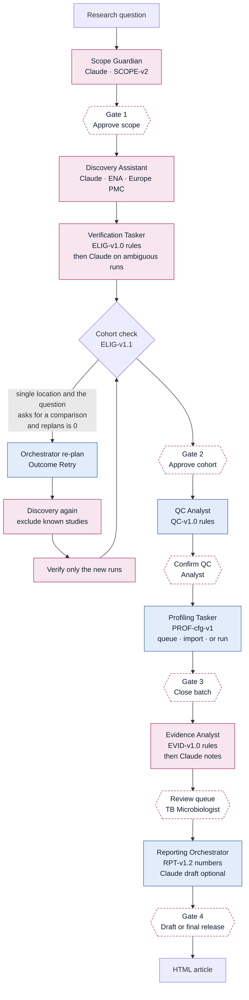

The Orchestrator is rule-based on purpose. It chooses who works next and when a human must approve. Judgment inside a stage belongs to an agent or a human.

| Member | Class | Kind | Tools | What the guardrail refuses |
|---|---|---|---|---|
| Orchestrator | `Orchestrator` | coordinator | hand-off, re-plan (max 1) | Skipping a gate. Re-planning more than once. |
| Scope Guardian | `ScopeGuardian` | Claude | none (reasons over the scope JSON) | Dropping one of the four required definitions. Approving its own scope. |
| Discovery Assistant | `DiscoveryAssistant` | Claude | `ena_search_runs`, `ena_study`, `find_publications` | Returning an accession no search returned. Deciding eligibility. |
| Verification Tasker | `VerificationTasker` | rules, then Claude | `ena_study`, `find_publications` | Verifying a run when a country-scoped search has an empty ENA country field. |
| QC Analyst | `QCAnalyst` | rules | coverage estimate, checksum flag | Changing thresholds. |
| Profiling Tasker | `ProfilingTasker` | tool runner | TB-Profiler subprocess or JSON import | Interpreting resistance. |
| Evidence Analyst | `EvidenceAnalyst` | rules, then Claude | none (reads the finding list) | Clearing a finding from review. Confirming resistance. |
| Reporting Orchestrator | `ReportingOrchestrator` | rules, then optional Claude text | none | Releasing the report. Inventing denominators. |

Rule versions stamped on decisions:

| Key | Version | Owner |
|---|---|---|
| `scope` | `SCOPE-v2` | Scope Guardian and scope gate |
| `elig` | `ELIG-v1.0` | Per-run eligibility |
| `cohort` | `ELIG-v1.1` | Cohort-level checks and the re-plan |
| `qc` | `QC-v1.0` | Coverage gate |
| `prof` | `PROF-cfg-v1` | Profiling queue and result recording |
| `evid` | `EVID-v1.0` | Finding classification |
| `rpt` | `RPT-v1.2` | Report assembly and release |

Thresholds live in one dict and are not editable from the API: minimum coverage 30×, borderline 25×, minimum depth 10 reads, minimum allele fraction 0.9, genome length 4,411,532 bp.

## 7. Agent loop

`RuleAgent` calls `decide()` and returns. `LLMAgent.run()` is the tool loop used by Scope Guardian, Discovery, Verification, and Evidence.

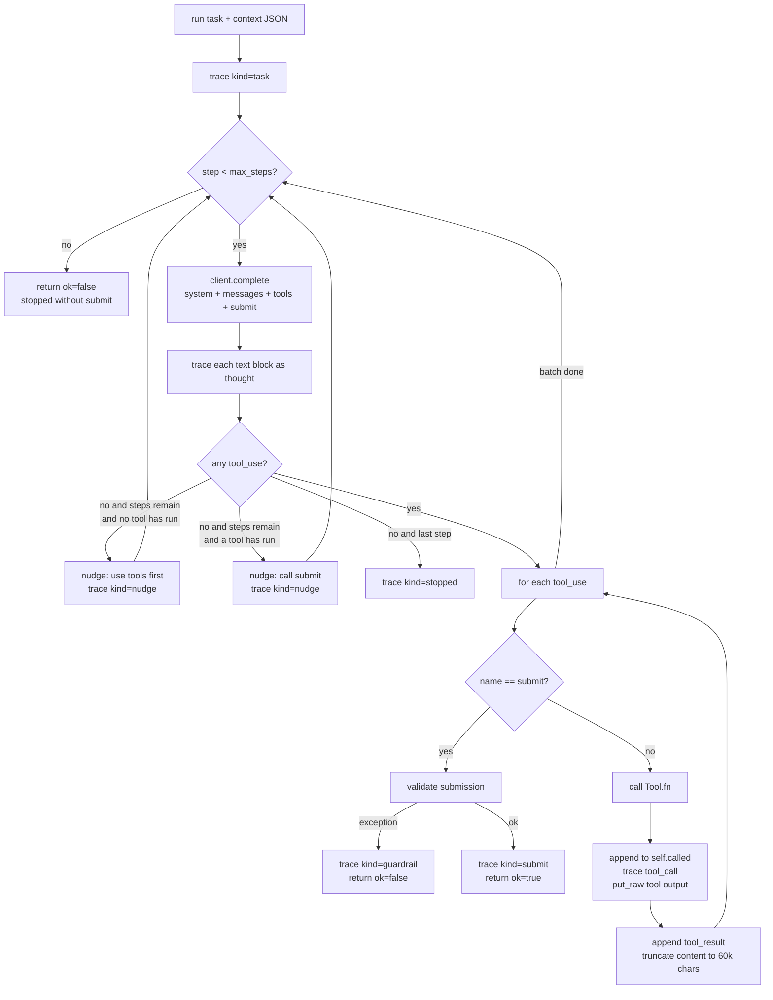

Shared system text (`GUARDRAILS_TEXT`) tells every Claude agent: use only the five outcomes, never invent accessions or publications, never relax a criterion to hit a sample count, never upgrade an uncertain finding, never make clinical or prevalence claims, escalate when ambiguous, and call `submit` exactly once.

Tool failures are returned to the model as `{"error": "..."}`. They do not crash the pipeline. A malformed `submit` is caught, traced as `guardrail`, and returned as `ok: false`. Callers then take a safe fallback (Scope Guardian emits the four required definitions and a warning; Discovery escalates with an empty candidate list).

`self.called` is the evidence bag `validate()` uses. Discovery's guardrail keeps only accessions present in `ena_search_runs` output and not in `already_known`. If the model submits an empty list, the fallback is every accession the tools actually returned.

Trace kinds written by the loop: `task`, `thought`, `nudge`, `tool_call`, `submit`, `guardrail`, `stopped`. The Orchestrator adds `handoff`. Full tool JSON is stored in `raw` under kind `tool`; the trace payload keeps a short preview so a large ENA page cannot blow the trace row (payloads over 20,000 characters are replaced with a truncation marker).

### Brains

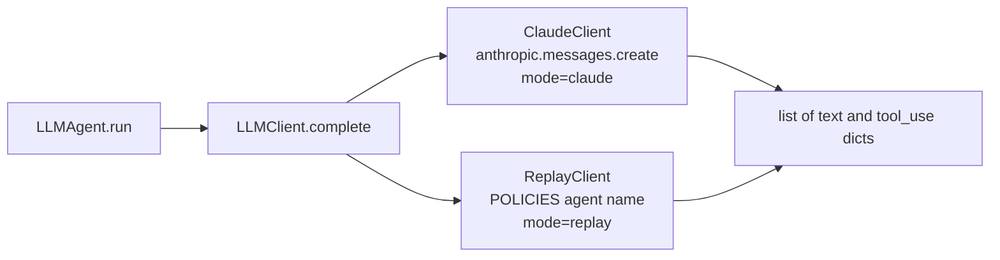

`make_client()` picks the implementation. `ClaudeClient` normalizes Anthropic content blocks to plain dicts so agents never import the SDK. `ReplayClient` looks up a policy in `llm/replay.py`, runs it against the message list, and assigns synthetic tool-use ids. Replay thoughts are prefixed `[replay]`. `ReportingOrchestrator.draft_summary` uses `client.text()`, a one-shot call with no tools. In replay that returns a template and then appends the real counts so the summary still contains the report numbers.

## 8. Stage implementation

### Stage 1 — Define and approve scope

`ScopeGuardian.review` sends the question, country, target drugs, cohort target, and the four required policy gaps. There are no tools. `max_steps` is 3.

`validate()` always restores any missing required gap (`verified_origin`, `missing_dst`, `duplicates`, `out_of_bounds`) and marks it `added_by: guardrail`. It also forces blocking items the model might omit: empty question, no target drugs, and geographic scope that is neither a country field nor an explicit place or worldwide wording in the question.

The input and the validated result are stored as `raw("scope", "guardian")`. The decision outcome is `Hold` when anything is blocking, otherwise `Escalate` (the scope is a proposal waiting for a human). `approve_scope` refuses the gate while `blocking` is non-empty. Only `pi` and `deputy` may approve.

`reopen_scope` sets stage 1 back to `ready`, clears samples, scope, checks, gates, report, replans, and pending overrides, and leaves the decision and trace tables intact.

### Stage 2 — Discover and verify

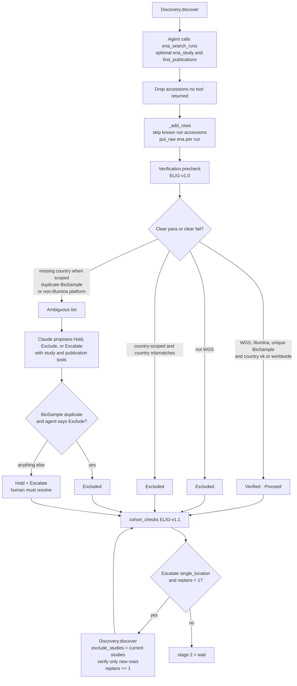

Country scoping: a country string other than empty, `worldwide`, `global`, or `any` turns origin into a gate. A missing country then goes to the agent and still ends as `Hold`, because a publication cannot verify origin. A worldwide search treats origin as informational.

Cohort checks look only at runs already marked `Verified`:

- All verified runs in one location, and the scope asked for a comparison across places → `Escalate` / `single_location`. This is the only check that triggers a re-plan.
- Same situation without a comparison question → `Proceed`, with a limitation that results describe that site.
- All verified runs from one study → `Proceed` / `single_study`.
- ENA reports more hits than were retrieved → `Proceed` / `search_limit`.

`approve_cohort` sets `in_cohort` on every `Verified` sample and records the check texts as accepted limitations. Holds can be resolved before or after approval. A verify decision after the cohort gate also sets `in_cohort` and calls `_revalidate`.

### Stage 3 — QC

`QCAnalyst.assess` skips samples that are not in the cohort or that already have a QC status. Estimated coverage is `base_count / 4_411_532`, rounded to one decimal.

| Coverage | Status | Outcome |
|---|---|---|
| No base count | Escalated | Escalate |
| below 25× | Excluded | Exclude |
| 25× up to but not including 30× | Escalated | Escalate |
| 30× or more | Pass | Proceed |

The note also records whether `fastq_md5` was present. The analyst confirms the batch (`confirm_qc`) and resolves each escalation with `proceed` or `exclude` plus a rationale.

### Stage 4 — Profiling

`ProfilingTasker.queue` marks each QC-passed run `Awaiting results`. In demo mode the orchestrator immediately applies `demo_tbprofiler_json` through the same `parse_result` path live imports use. In live mode the analyst either uploads `results/<RUN>.results.json` or starts a local run.

`parse_result` accepts TB-Profiler 4.x–6.x shapes: `dr_variants` with `drugs` or `annotation`, several version and lineage field names, and WHO confidence strings mapped to grades 0, 1, 2, 3, and 5. The tasker stores lineage, drug-resistance type, and the mutation list on the sample. It does not classify them.

`run_profiler` checks the analyst role, then starts a daemon thread. Inside it, `capture_execution` records the batch, and a `ThreadPoolExecutor` runs one sample per worker. Each worker calls `TBProfilerRunner.run`:

1. Refuse if `fasterq-dump` or a profiler backend is missing.
2. Reuse an existing `results/<RUN>.results.json` when present.
3. Skip `fasterq-dump` when both FASTQ files are already non-empty.
4. Otherwise download with `fasterq-dump --split-files`, then profile.
5. Prefer Docker image `staphb/tbprofiler` (`--platform linux/amd64`) when the image is present, unless `TBAMR_PROFILER_BACKEND=local`.

While workers run, `busy` is set to a short label (`TB-Profiler: ERR123, ERR456 + 2 more`). The UI polls `/api/state` every 1.5 seconds and `/api/trace` every 1.2 seconds whenever `busy` is set. The HTTP handler returns `{started, concurrency, threads_per_sample}` immediately. The execution row is written when the pool finishes, including per-run status.

`close_profiling` requires at least one `Done` result. If results are imported after stage 5 has already evaluated, evidence is recomputed for newly finished samples and any existing report is marked superseded.

### Stage 5 — Evidence

`classify()` builds one `Finding` per mutation annotation:

| Condition | Class | Review |
|---|---|---|
| Grade 5 (not associated with resistance) | `other` | Not required. Not counted as resistance. |
| Grade 3 (uncertain) | `uncertain` | Pending. Cannot be promoted by an agent. |
| Depth present and below 10 | `tech` | Pending. |
| Allele fraction below 0.9 | `tech` | Pending. Possible mixture or heteroresistance. |
| Matched DST is susceptible | `tech` | Pending. Discordance. |
| Otherwise | `tech` | Not required. Grade 0 means the catalogue grade was absent from the file. |

The Claude pass receives that classification as context and returns a note per finding id. `validate()` drops notes whose `fid` is not in the context. If the model sets `request_review` on a finding that was `Not required` and is not class `other`, the finding moves to `Pending`. The reverse is ignored. A failed model call leaves the rule classification in place with no interpretation note.

Only the TB Microbiologist may set a pending finding to `Reviewed`, `Not supported`, or `Needs more data`, and only with a rationale. The decision outcome is `Proceed`, `Exclude`, or `Hold` respectively.

### Stage 6 — Report and release

`ReportingOrchestrator.build` derives every count from current state:

- **Candidates** — all samples.
- **Verified** — `in_cohort` and eligibility `Verified`.
- **QC passed** — those with `qc == Pass`.
- **Analysed** — QC passed, profiling `Done`, and `profile_meta.evaluated`.

Drug rows use analysed samples as the denominator. A sample is predicted resistant for a drug when it has a `tech` finding for that drug whose review is not `Not supported`. Uncertain or still-pending findings are counted separately and are not folded into the resistant count. DST concordance is computed only for samples that actually carry a DST result for that drug. Missing DST is never agreement or disagreement.

The report also stores top mutations, lineages, exclusion reasons, unresolved findings, limitations (cohort checks plus the standing non-prevalence and non-clinical limits), tool and database versions, the gate record, and rule versions. The whole dict is stored as `raw("report", version)`.

`draft_summary` is a separate human-triggered call. `save_summary` stores edited text and sets `summary_edited`. Release kind `draft` records the gate and leaves stage 6 at `wait`. Kind `final` is refused while `unresolved` is non-empty or `superseded` is true, then sets stage 6 to `done`.

`article.py` renders that same dict to one HTML file with inline CSS and inline SVG. It does not recompute numbers. `GET /api/report/{version}/article.html?print=1` opens the browser print dialog; `?download=1` sets `Content-Disposition: attachment`.

## 9. Decision contract and audit store

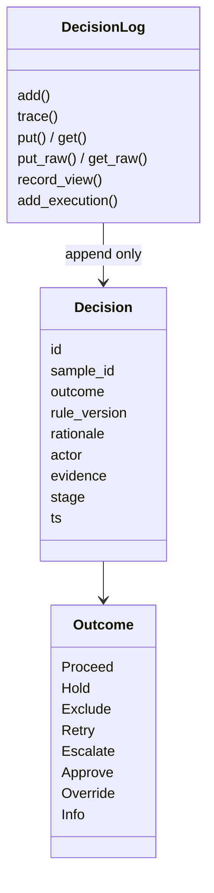

`check_agent_decision` runs inside `DecisionLog.add` before the insert:

- An actor starting with `agent:` may use only `Proceed`, `Hold`, `Exclude`, `Retry`, `Escalate`, and `Info`.
- That decision must have a sample id, a rule version, and a non-empty rationale.
- `Approve` and `Override` are rejected for agents with `GuardrailViolation`.

Actors look like `agent:verification`, `agent:orchestrator`, or `human:pi:Minnie`. Sample ids are run accessions, or the sentinels `—`, `SCOPE`, and `COHORT` for decisions that are not about one run.

### SQLite tables

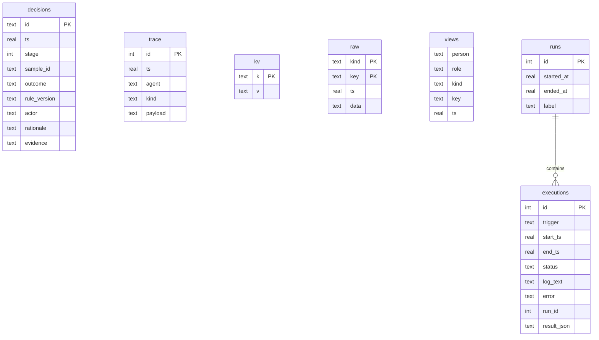

| Table | Written by | Read by |
|---|---|---|
| `decisions` | `decide()`, `human()`, override apply | Insights, sample drawer, metrics |
| `trace` | agent loop and orchestrator hand-offs | Team cards, busy bar, trace API |
| `kv` | `state` and `pending_overrides` | Orchestrator startup |
| `raw` | ENA rows, scope, evidence, TB-Profiler JSON, report, full tool output | Raw viewer |
| `views` | `record_view` on raw open (not on `kind=tool`) | Receipts and the evidence line of the next decision |
| `runs` | one open row; reset closes it and opens another | Logs tab run picker |
| `executions` | `capture_execution` at the end of each user action | Logs tab |

Connections use `check_same_thread=False` plus an `RLock`, because FastAPI worker threads and profiler threads share one connection.

Reset does not delete the database file while requests may still be reading it. If the active run has executions, it is closed with a label taken from the report version, the approved scope, or the question. Then `decisions`, `trace`, `kv`, `raw`, and `views` are deleted in place, a new run row is inserted, and a fresh orchestrator is built on the same path. Executions survive, so the Logs tab can open a previous cycle. Switching demo and live uses a different default filename (`tbamr-demo.db` versus `tbamr-live.db`).

### Raw data assembly

`GET /api/raw/{kind}/{key}` calls `raw_view`, which backfills older pipelines when it can, records a receipt, and returns a title, source, explanation, optional table, and the JSON. Kinds:

| Kind | Key | Contents |
|---|---|---|
| `scope` | `guardian` | Guardian input, validated result, brain mode |
| `ena` | run accession | Archive record, agent evidence, derived coverage, current status |
| `cohort` | `all` | One row per candidate plus eligibility |
| `qc` | `all` | Base count, genome length, coverage, checksum, QC status |
| `profiling` | `all` | Batch summary; each run's full JSON is kind `tbprofiler` |
| `tbprofiler` | run accession | Verbatim result file |
| `report` | version | The report dict |
| `tool` | trace id | Full tool input and output. Viewing it does not write a receipt. |
| `evidence` | run accession | Stored for the drawer; assembled inside the `ena` payload |

If the person decides without opening the raw data, the decision's evidence field says so. The decision is still accepted.

### Metrics

`Orchestrator.metrics` is computed from the decision and trace tables, not stored:

- Decision counts split into agent and human.
- Agreement is `Approve / (Approve + Override)`.
- Escalation rate is `Escalate / agent decisions` excluding `Info` from the agent denominator's companion count (Info is excluded from `agent_decisions`).
- Per escalated run, resolution time is the first human decision minus the first escalate.
- A later human `Proceed` on that run counts as a possible false hold.
- Tool-call counts and guardrail events come from the trace.

## 10. Overrides

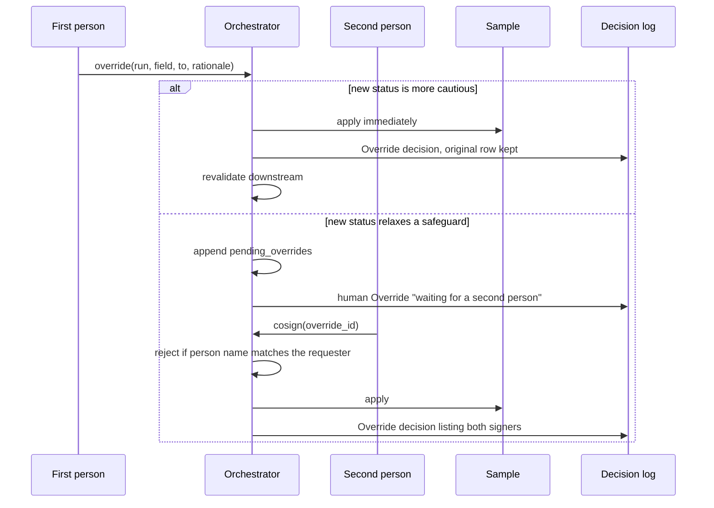

Fields are `eligibility` (`Verified` < `Hold` < `Excluded`) and `qc` (`Pass` < `Escalated` < `Excluded`). Moving right on that order is more cautious and applies at once. Moving left waits. The co-signer must have a non-empty name that differs from the requester's; the role only has to be a known role. Applying an eligibility override away from `Verified` removes the run from the cohort. `_revalidate` marks the report superseded and, if the run is newly eligible or newly passed, queues the QC or profiling step it skipped.

## 11. Frontend

The UI is a single React 18 page with no router. `App` holds server snapshot, team cards, decisions, metrics, the selected tab, the pipeline stage in view, the acting role, and the raw-data request.

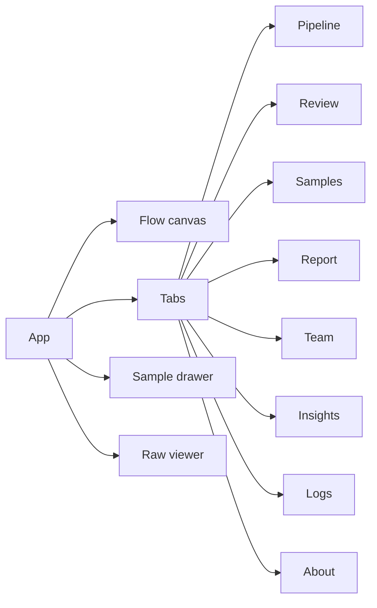

On load, and after every action, the client fetches `/api/state`, `/api/team`, `/api/decisions`, and `/api/metrics` together. Actions go through `act()`: it starts the POST, polls state about every 700 ms until the POST settles, then refreshes once more and jumps the pipeline view to the first stage in `wait` or `ready`. Errors surface as a toast from the FastAPI `detail` string (`403` permission, `409` stage or guardrail, `404` missing raw data).

| Tab | Reads | Writes |
|---|---|---|
| Pipeline | `state.stage_status`, samples, scope, cohort checks | scope, run stage, gates, hold and QC resolution, profiler import and run |
| Review queue | findings with `review == Pending` | `/api/review` |
| Samples | all samples | opens the drawer (overrides and co-sign) |
| Report | `state.report` | summary draft, summary save, release, article link |
| Agent team | `/api/team` cards plus `/api/trace` | none |
| Decisions and metrics | `/api/metrics`, `/api/decisions` | none |
| Logs | `/api/runs`, `/api/executions`, `/api/executions/{id}` | none |
| About | static | none |

The Flow canvas is a stage strip, not a second source of truth. Status classes come from `stage_status`. Hover lists the agents on that stage and whether each is `llm` or `rule`.

## 12. HTTP surface

| Method | Path | Effect |
|---|---|---|
| GET | `/api/state` | Pipeline snapshot, mode, profiler capacity, role and stage catalogues |
| GET | `/api/team` | Agent cards with activity counts |
| GET | `/api/decisions` | Decision log, optional `sample` filter |
| GET | `/api/trace` | Agent trace, optional `agent`, default limit 300 |
| GET | `/api/metrics` | Trust metrics |
| GET | `/api/raw/{kind}/{key}` | Raw payload; records a view receipt |
| GET | `/api/raw/receipts` | Receipts for the named person |
| POST | `/api/scope` | Edit question, country, drugs, cohort target while stage 1 is ready |
| POST | `/api/scope/reopen` | Return to stage 1, keep history |
| POST | `/api/stages/{n}/run` | Run stage `n` |
| POST | `/api/gates/scope` | Approve scope |
| POST | `/api/gates/cohort` | Approve cohort |
| POST | `/api/gates/qc` | Confirm QC |
| POST | `/api/gates/profiling` | Close profiling batch |
| POST | `/api/holds/resolve` | Verify, exclude, or keep a hold |
| POST | `/api/qc/resolve` | Proceed or exclude an escalated QC result |
| POST | `/api/review` | Microbiologist finding decision |
| POST | `/api/overrides` | Request or immediately apply an override |
| POST | `/api/overrides/cosign` | Second signature |
| POST | `/api/release` | `draft` or `final` |
| POST | `/api/report/summary` | Ask the reporting agent to draft prose |
| PUT | `/api/report/summary` | Save human-edited prose |
| GET | `/api/report/{version}/article.html` | Printable HTML article |
| POST | `/api/profiling/import` | Multipart TB-Profiler JSON |
| POST | `/api/profiling/run` | Start the background profiler pool |
| POST | `/api/reset` | Close the run, clear workflow tables, rebuild the orchestrator |
| GET | `/api/runs` | Pipeline cycles, newest first |
| GET | `/api/executions` | Executions for a run |
| GET | `/api/executions/{id}` | Log text and structured result |

Mutating routes wrap the orchestrator call in `capture_execution`. `guard()` maps `PermissionDenied` to 403 and `StageError` or `GuardrailViolation` to 409.

Other entry points hit the same orchestrator methods without HTTP:

- `python -m tbamr.cli` walks all six stages in a temporary database, acting as PI and analyst. `--live` and `--brain claude` switch modes.
- `python -m tbamr.harness seed` drives the HTTP routes against demo data so the Logs tab has executions, then `serve` starts uvicorn on `tbamr-harness.db`. `--reseed` only deletes a path whose name contains `harness`.

## 13. External tool contracts

### ENA and Europe PMC (`tools/ena.py`)

`DataTools` uses one `httpx.Client` (30 second timeout, a fixed user agent). Searches are `tax_tree(1773)` (Mycobacterium tuberculosis) against the ENA `read_run` result, optionally `AND country="<name>*"`, paged at 200 rows up to a limit of 500. The returned object is `{query, returned, total_in_ena, runs}`. Run fields are accession, sample, study, country, library strategy and layout, instrument platform, base count, and FASTQ MD5. `ena_study` reads study title. `find_publications` queries Europe PMC lite results and keeps title, authors, journal, year, PMID, and DOI.

Empty HTTP bodies become empty lists. A failed count request leaves `total_in_ena` null rather than failing the search. `DemoDataTools` implements the same method names and flags `is_demo = True`, which the orchestrator uses to attach simulated DST and to synthesize TB-Profiler JSON.

### TB-Profiler (`tools/tbprofiler.py`)

Work directory defaults to `tbprofiler_runs/<RUN>/`. A successful `run()` returns `{ok, result, raw}` where `result` is the parsed mutation list and `raw` is the file JSON stored verbatim. Failures return `{ok: false, error}` and the tasker marks the sample `Failed` with an `Escalate` decision. Cached JSON short-circuits a repeat run.

## 14. Tests and CI

CI (`.github/workflows/ci.yml`) on push and pull request:

- Python 3.12, `pip install -r backend/requirements.txt`, `pytest -q` from `backend/`.
- Node 20, `npm install`, `npm run build` from `frontend/`.

`pyproject.toml` skips markers `ui` and `live` by default. `ui` is Playwright against the built bundle. `live` hits the real ENA Portal API. The default suite covers the decision contract, raw-data receipts, the demo walkthrough, role checks, gates, the two-person rule, re-planning, agent guardrails, the TB-Profiler parser for v4 and v6 shapes, ENA paging with mocked HTTP, the Claude request shape with a mocked SDK, and the HTTP API.

## 15. What runs where, in one pass

A live Indonesian cohort with Claude, from the first click to a draft report:

1. The browser loads `index.html` from FastAPI. `App` fetches state. Stage 1 is `ready`. The brain tag reads `claude` because the API key is set. The data switch reads `live`.
2. The researcher sets the question and country. `POST /api/scope` writes them onto `PipelineState` only, because the guardian has not run.
3. `POST /api/stages/1/run` calls Claude with the scope JSON. Validation restores the four definitions. Stage 1 becomes `wait`. The PI approves. Stage 2 unlocks. Both actions are decisions plus an execution row.
4. Discovery pages ENA and may call Europe PMC. Verification's rules classify every new run; Claude investigates only the ambiguous ones; country-missing runs stay on hold. If every verified run is one location and the question compares places, Discovery is called once more with `study_accession` exclusions. The PI approves the cohort. Verified runs gain `in_cohort`.
5. QC computes coverage. The analyst resolves borderline runs and confirms the batch.
6. The analyst starts TB-Profiler. The request returns while workers download FASTQs and run the Docker image. The busy bar shows the latest trace lines. When results land, the analyst closes the batch.
7. Evidence classification is deterministic. Claude attaches interpretation notes and may add review flags, never remove them. The microbiologist works the queue.
8. Reporting recomputes denominators and stores report v1. A summary draft is optional. Exploratory release is allowed with unresolved findings. Final release is not.

Demo plus replay follows the same call graph. The only substitutions are `DemoDataTools` for HTTP and `ReplayClient` for Anthropic, and stage 4 fills results from the simulated JSON instead of a subprocess.
