# TB-AMR Agent Team (Python + React)

A **hybrid agentic workflow** for *Mycobacterium tuberculosis* drug-resistance genomic evidence, built for the A.G.E.N.T. Playbook capstone (*TB Antimicrobial Resistance in Indonesia*).

Each member of the team is its own Python class. **Claude agents** are given a goal and tools and decide which tools to call and when to stop. **Rule agents** do the steps that must be reproducible. The **Orchestrator** hands work between them, re-plans when an agent escalates, and stops at every human gate.

> v0.2 · offline demo works out of the box. Live ENA data and Claude reasoning are built in and switched on by environment variables (see below). Genomic predictions are not laboratory-confirmed susceptibility and cannot estimate national prevalence.

```mermaid
flowchart LR
  H1{{Gate 1<br/>Approve scope}}:::gate
  H2{{Gate 2<br/>Approve cohort}}:::gate
  H3{{Gate 3<br/>Close profiling batch}}:::gate
  H4{{Review queue<br/>TB Microbiologist}}:::gate
  H5{{Gate 4<br/>Release}}:::gate
  O((Orchestrator))
  SG[Scope Guardian<br/>Claude agent]:::llm --> H1
  H1 --> D[Discovery Assistant<br/>Claude agent<br/>ENA · Europe PMC]:::llm
  D --> V[Verification Tasker<br/>rules + Claude agent]:::llm
  V -- single location & regional question --> O
  O -- re-plan: find other studies --> D
  V --> H2 --> QC[QC Analyst<br/>rules]:::rule --> P[Profiling Tasker<br/>TB-Profiler runner]:::rule
  P --> H3 --> E[Evidence Analyst<br/>rules + Claude agent]:::llm --> H4
  H4 --> R[Reporting Orchestrator<br/>rules + Claude draft]:::rule --> H5
  classDef llm fill:#f7e6ee,stroke:#a8215f,color:#142133;
  classDef rule fill:#e3ecfa,stroke:#2c5d9e,color:#142133;
  classDef gate fill:#fff,stroke:#a8215f,stroke-dasharray:4 3,color:#142133;
```



## The team

| Member | Type | Tools | Guardrail (what it can never do) |
|---|---|---|---|
| Orchestrator | coordinator | hand-off, re-plan (max 1) | skip a human gate |
| Scope Guardian | Claude agent | — (reasons over the scope) | drop one of the 4 required playbook definitions |
| Discovery Assistant | Claude agent | `ena_search_runs` (paged), `ena_study`, `find_publications` | return an accession no tool returned |
| Verification Tasker | rules + Claude agent | `ena_study`, `find_publications` | verify a run whose ENA country field is missing |
| QC Analyst | rules | coverage estimate, checksum | change thresholds |
| Profiling Tasker | tool runner | TB-Profiler (subprocess) or JSON import | interpret results |
| Evidence Analyst | rules + Claude agent | — (reads findings) | clear a finding from review, or confirm resistance |
| Reporting Orchestrator | rules + Claude draft | — | release the report |

Shared contract for everyone: five outcomes (**Proceed · Hold · Exclude · Retry · Escalate**), every decision logged with sample, rule version, rationale and time; humans-only outcomes (**Approve**, **Override**); overrides never erase history; relaxing a safeguard needs **two different named people**. Every agent step (task, reasoning, tool call, submission, guardrail rejection) is stored in an **agent trace** you can read in the UI.

## Run it on a Mac

You need Python 3.10+ (`python3 --version`). Node is only needed if you want to change the screen.

Quickest way: `./run.sh` (offline demo) or `./run.sh live` (real ENA data). It creates a virtual environment the first time.

Or step by step:

```bash
cd backend
python3 -m venv .venv && source .venv/bin/activate
pip install -r requirements.txt
uvicorn tbamr.api:app --port 8000
```

Open **http://localhost:8000**. The React screen is already built (`frontend/dist`) and served by the backend.

### Modes

| Variable | Values | Default |
|---|---|---|
| `TBAMR_DATA` | `demo` (simulated records, offline) · `live` (real ENA + Europe PMC) | `demo` |
| `TBAMR_BRAIN` | `replay` (scripted agents, no key) · `claude` (live reasoning) | `claude` if `ANTHROPIC_API_KEY` is set, else `replay` |
| `ANTHROPIC_API_KEY` | your key from console.anthropic.com | — |
| `CLAUDE_MODEL` | any Messages API model id | `claude-sonnet-4-5` |
| `TBAMR_DB` | path of the SQLite decision log | `tbamr-<data>.db` |

```bash
# real Indonesian ENA data, Claude-powered agents
export ANTHROPIC_API_KEY=sk-ant-...
TBAMR_DATA=live uvicorn tbamr.api:app --port 8000
```

Command-line walkthrough (acts as each human in turn): `python -m tbamr.cli` · `python -m tbamr.cli --live --brain claude`

### TB-Profiler

If `tb-profiler` and `fasterq-dump` are on the PATH where the backend runs, Stage 4 shows **Run TB-Profiler**. Otherwise run it yourself and drop the `results/<RUN>.results.json` files on the Stage 4 import area. The parser handles TB-Profiler 4.x–6.x layouts; check against your version.

## Tests

```bash
cd backend && python -m pytest -q
```

14 tests cover the decision contract, the full demo flow, role enforcement, gates, the two-person rule, Orchestrator re-planning, every agent guardrail, the TB-Profiler parser (v4 and v6 shapes), ENA paging (mocked HTTP), the Claude request format (mocked SDK) and the HTTP API.

## Layout

```
backend/tbamr/
  core/decisions.py      decision contract, guardrails, SQLite log + agent trace
  core/models.py         samples, findings, stages, gates, rule versions
  core/orchestrator.py   hand-offs, human gates, re-planning, overrides, metrics
  agents/                one file per team member
  tools/ena.py           ENA Portal API + Europe PMC
  tools/tbprofiler.py    TB-Profiler runner + JSON parser
  tools/demo.py          simulated records (DEMO/PRJDEMO accessions only)
  llm/client.py          Claude client + replay client
  llm/replay.py          scripted policies for offline runs
  api.py                 FastAPI endpoints
frontend/src/            React screen (Vite)
```

## What has and hasn't been verified

- ✅ Offline demo, end to end, in a browser (all six stages, review, report, metrics, overrides).
- ✅ Claude request format checked against a mocked SDK.
- ⚠️ **Live Claude reasoning has not been run yet** (needs your API key). Agents may phrase things differently from the replay scripts; the guardrails apply either way.
- ⚠️ **Live ENA/Europe PMC calls were not reachable from the build environment**; the paging logic is tested with mocked HTTP. Try `python -m tbamr.cli --live` first.
- ⚠️ **TB-Profiler runner not executed** (tools not installed in the build environment).
